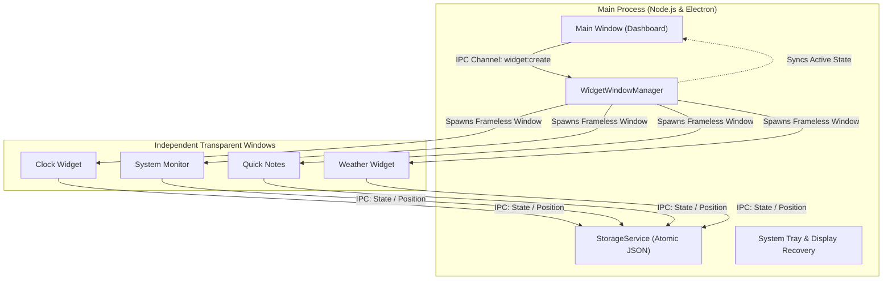

# 🌟 Z-Widgets

<p align="center">
  <strong>A modern, ultra-fast, cross-platform desktop widget suite with a native macOS aesthetic.</strong>
</p>

<p align="center">
  
  
  
  
  
  
</p>

---

## 📑 Quick Navigation

- [✨ Features](#-features)
- [🧩 Included Widgets](#-included-widgets)
- [🏗️ How It Works (Architecture)](#️-how-it-works-architecture)
- [🚀 Quick Start](#-quick-start)
- [📦 Packaging for Mac, Windows & Linux](#-packaging-for-mac-windows--linux)
- [⌨️ Keyboard Shortcuts](#️-keyboard-shortcuts)
- [📂 Project Structure](#-project-structure)
- [👤 Author & Credits](#-author--credits)

---

## ✨ Features

- 🍎 **Native Apple Design** — Sleek frosted-glass blur (vibrancy), smooth rounded corners, native traffic light controls, and Apple green toggles.
- 🪟 **Independent Floating Windows** — Each widget runs in its own transparent, draggable, lightweight multi-window process.
- 📌 **3 Placement Modes** — Pin widgets to `Desktop` (stays behind apps), make them `Floating`, or set to `Always on Top`.
- 💾 **Smart Auto-Save** — Automatically remembers widget positions `(x, y)`, sizes, and states across app restarts.
- 🖥️ **Multi-Monitor Recovery** — Automatically pulls widgets back into view if you disconnect an external monitor.
- ⚡ **Instant Search** — Live filter widgets with `Cmd/Ctrl + F`.
- 🎛️ **System Tray Integration** — Quick toggle menu right from your macOS Menu Bar or Windows Taskbar.

---

## 🧩 Included Widgets

| Widget | Icon | Description | Placement |
| :--- | :---: | :--- | :--- |
| **System Monitor** | ⚡ | Real-time CPU usage, RAM utilization, core count & system uptime | Desktop / Floating |
| **Digital Clock** | 🕒 | Clean digital clock with seconds, date, and modern typography | Desktop / Floating |
| **Quick Notes** | 📝 | Scratchpad sticky notes that auto-save your thoughts instantly | Desktop / Floating |
| **To-Do List** | ✅ | Interactive daily checklist to track and finish your tasks | Desktop / Floating |
| **Live Weather** | ⛅ | Real-time temperature, condition icons, and multi-city search | Desktop / Floating |
| **Duo Calendar** | 📅 | Dual-month overview calendar with current date highlighter | Desktop / Floating |
| **Photo Frame** | 🖼️ | Desktop slideshow with custom intervals and photo picker | Desktop / Floating |
| **Depth Dive** | 🌊 | Ambient sound & music companion widget with interactive controls | Desktop / Floating |
| **Telemetry** | 🌐 | Internet ping, latency monitor, and network health tracker | Desktop / Floating |

---

## 🏗️ How It Works (Architecture)

Z-Widgets uses a **Multi-Window Electron Architecture** for maximum performance and silky-smooth 60fps animations.



- **Main Dashboard**: The catalog where you browse, search, and toggle widgets.
- **Widget Host**: Frameless, transparent windows rendered via React + Tailwind.
- **Preload Bridge**: Secure context-isolated IPC channels between React and Electron.

---

## 🚀 Quick Start

### Prerequisites
Make sure you have [Node.js](https://nodejs.org/) (v18+) installed.

### 1. Clone the repository
```bash
git clone https://github.com/your-username/Z-Widgets.git
cd Z-Widgets
```

### 2. Install dependencies
```bash
npm install
```

### 3. Run in development mode
```bash
npm run dev
```

### 4. Run tests & verification
```bash
npm test
```

---

## 📦 Packaging for Mac, Windows & Linux

Generate standalone installer apps with a single command (no code shown to end users):

| Platform | Command | Output File in `dist/` |
| :--- | :--- | :--- |
| 🍏 **macOS** | `npm run build:mac` | `Z-Widgets-0.1.0-arm64.dmg` *(or .zip)* |
| 🪟 **Windows** | `npm run build:win` | `Z-Widgets Setup 0.1.0.exe` |
| 🐧 **Linux** | `npm run build:linux` | `Z-Widgets-0.1.0.AppImage` |
| 🌍 **All Platforms** | `npm run build:all` | Builds for all three OS |

> [!TIP]
> **First-time macOS Opening**:  
> If macOS displays an *"Unidentified Developer"* alert on an unsigned build, simply **Right Click (Control + Click) > Open**, or run:
> ```bash
> xattr -cr /Applications/Z-Widgets.app
> ```

---

## ⌨️ Keyboard Shortcuts

| Shortcut | Action |
| :--- | :--- |
| `Cmd / Ctrl + F` | Focus the widget search bar instantly |
| `Esc` | Close Settings modal / Clear search query |
| `Cmd / Ctrl + W` | Hide the main dashboard window |
| `Cmd / Ctrl + Q` | Quit the application completely |

---

## 📂 Project Structure

```text
Z-Widgets/
├── resources/              # App icons, tray icons, and media assets
├── src/
│   ├── main/               # Electron Main Process
│   │   ├── services/       # Window manager, tray, storage, system & weather APIs
│   │   └── index.ts        # App lifecycle & IPC setup
│   ├── preload/            # Context isolation IPC bridges
│   │   └── index.ts        # Safe window.api exposure
│   ├── renderer/           # React 18 UI
│   │   ├── src/
│   │   │   ├── widgets/    # All 9 standalone widget components
│   │   │   ├── App.tsx     # Main macOS-styled widget dashboard
│   │   │   ├── main.tsx    # React entry point
│   │   │   └── index.css   # Tailwind styles & theme variables
│   │   └── index.html      # HTML entry template
│   └── shared/             # Shared TypeScript types, constants & IPC contracts
├── electron.vite.config.ts # Unified Vite build config
└── package.json            # Scripts & electron-builder packaging rules
```

---

## 👤 Author & Credits

Crafted with passion by **Zeesu Royalist**.

- 🌐 **Portfolio**: [zeesu-royalist.vercel.app](https://zeesu-royalist.vercel.app)
- 💼 **Project**: Z-Widgets (v0.1.0)
- 📄 **License**: [MIT](LICENSE)

