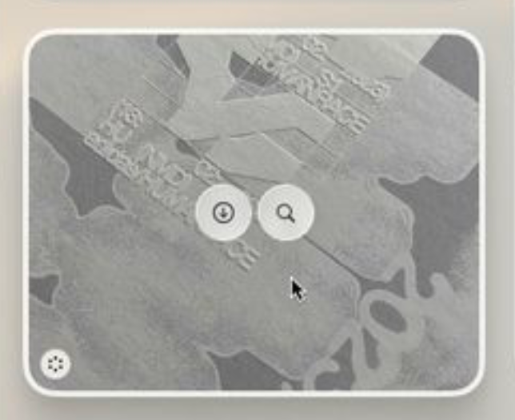

# 🌟 Z-Widgets

<p align="center">
  <strong>A modern, lightweight desktop widget suite with a native Apple macOS aesthetic.</strong>
  <br />
  <em>Everything you need — system stats, sticky notes, weather, and clock — floating right on your desktop.</em>
</p>

<p align="center">
  
  
  
  
  
  
</p>

<p align="center">
  
</p>

---

## ⬇️ Direct 1-Click Downloads (Install Ready)

No coding required! Download the ready-to-run app for your computer:

| Operating System | Download File | Size | How to Run |
| :--- | :--- | :---: | :--- |
| 🍏 **macOS** *(Apple Silicon)* | [**Download .dmg**](dist/Z-Widgets-0.1.0-arm64.dmg) | `94 MB` | Double-click `.dmg` & drag to Applications |
| 🪟 **Windows** *(64-bit & ARM)* | [**Download .exe Setup**](dist/Z-Widgets%20Setup%200.1.0.exe) | `77 MB` | Double-click installer `.exe` & launch |
| 🐧 **Linux** *(Standard x64)* | [**Download .AppImage**](dist/Z-Widgets-0.1.0.AppImage) | `79 MB` | Right-click > Allow executing as program > Run |
| 🐧 **Linux** *(ARM64)* | [**Download .AppImage (arm64)**](dist/Z-Widgets-0.1.0-arm64.AppImage) | `73 MB` | Standalone executable for ARM Linux |

> [!TIP]
> **First-time macOS Opening**:  
> If Mac displays an *"Unidentified Developer"* alert on an unsigned build, simply **Right Click (Control + Click) > Open**, or run this 1-line command in Terminal:
> ```bash
> xattr -cr /Applications/Z-Widgets.app
> ```

---

## ❓ Why Z-Widgets? (App Kyu Hai?)

Most operating systems either don't have widgets, or hide them behind sidebars and menus. Switching browser tabs just to take a quick note, check CPU usage, or check the weather breaks your focus.

**Z-Widgets solves this problem:**
- It puts elegant, distraction-free widgets directly on your desktop.
- Everything important is **always one glance away**.
- Built with Apple's clean design principles — rounded corners, frosted glass vibrancy blur, and zero clutter.

---

## 🎯 What Does It Do? (Kya Karta Hai?)

Z-Widgets gives you **9 high-performance desktop widgets** that you can toggle on or off with a single click:

| Widget | What It Does | Placement Mode |
| :--- | :--- | :--- |
| ⚡ **System Monitor** | Live CPU usage, RAM utilization, core count & uptime | Desktop / Floating |
| 🕒 **Digital Clock** | Sleek modern clock with date, seconds, and time | Desktop / Floating |
| 📝 **Quick Notes** | Sticky note scratchpad that auto-saves your text instantly | Desktop / Floating |
| ✅ **To-Do List** | Daily checklist with interactive checkboxes to finish tasks | Desktop / Floating |
| ⛅ **Live Weather** | Real-time temperature, weather icon, and multi-city search | Desktop / Floating |
| 📅 **Duo Calendar** | Dual-month calendar with today's date highlighted | Desktop / Floating |
| 🖼️ **Photo Frame** | Rotating desktop slideshow with custom interval & fit mode | Desktop / Floating |
| 🌊 **Depth Dive** | Ambient sound and audio companion widget | Desktop / Floating |
| 🌐 **Telemetry** | Internet ping and network latency monitor | Desktop / Floating |

---

## ✨ Key Highlights

- 🪟 **Multi-Window Transparency** — Each widget runs in its own frameless, transparent, draggable window.
- 📌 **3 Placement Modes** —
  - **Desktop**: Pinned behind all your open apps (never gets in your way).
  - **Floating**: Moves freely across your screen.
  - **Always on Top**: Stays above all windows for urgent tasks.
- 💾 **Smart Auto-Save** — Remembers exact screen coordinates `(x, y)` and sizes across restarts.
- 🖥️ **Display Watcher** — Disconnecting an external monitor? Widgets automatically pull back into your main screen.
- ⚡ **Instant Search** — Press `Cmd/Ctrl + F` to find any widget in milliseconds.
- 🎛️ **Menubar / System Tray** — Quick show/hide toggle right from your top menu bar.

---

## ⌨️ Keyboard Shortcuts

| Shortcut | Action |
| :--- | :--- |
| `Cmd / Ctrl + F` | Instant focus on the widget search bar |
| `Esc` | Close Settings modal / Clear search query |
| `Cmd / Ctrl + W` | Hide the dashboard to system tray |
| `Cmd / Ctrl + Q` | Quit the application completely |

---

## 🛠️ Developer Setup (Build from Source)

If you want to modify or run the source code:

```bash
# 1. Clone the repo
git clone https://github.com/your-username/Z-Widgets.git
cd Z-Widgets

# 2. Install dependencies
npm install

# 3. Start development server
npm run dev

# 4. Build for your OS
npm run build:mac     # For macOS (.dmg)
npm run build:win     # For Windows (.exe)
npm run build:linux   # For Linux (.AppImage)
```

---

## 👤 Author & Credits

Crafted with care by **Zeesu Royalist**.

- 🌐 **Portfolio**: [zeesu-royalist.vercel.app](https://zeesu-royalist.vercel.app)
- 💼 **Project**: Z-Widgets (v0.1.0)
- 📄 **License**: [MIT](LICENSE)
